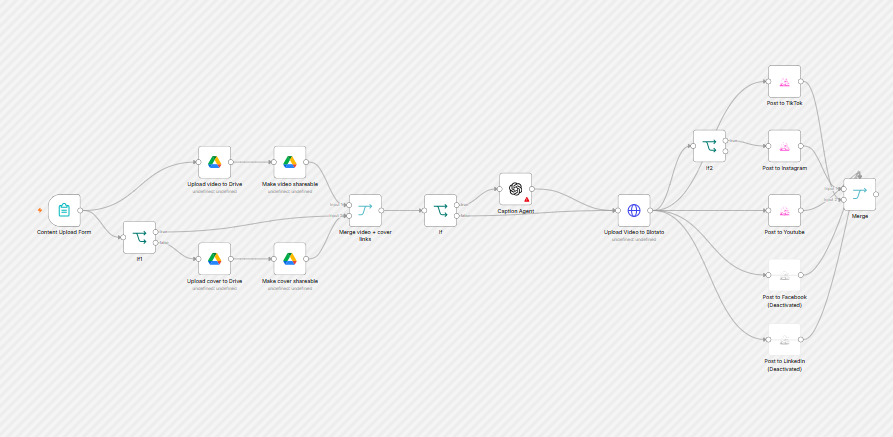

# Blotato social publisher

Upload a video once and publish it to several social networks, with AI-written captions tailored to each platform.

**Status:** built from scratch and used to publish real videos to my own TikTok, Instagram and YouTube accounts.

## How it works

1. **Form trigger:** an n8n form collects the title, an optional description, the video (`.mp4`/`.mov`), an optional cover image and the target platforms.
2. **Google Drive:** the video (and the cover, if provided) is uploaded to Drive and made shareable, so Blotato can fetch it by URL.
3. **Caption agent:** if the description is left as `AI`, GPT-4o writes one caption per platform, following each platform's length limits and best practices, and returns them as JSON. Otherwise your own description is used everywhere.
4. **Blotato:** the video is uploaded to Blotato's media endpoint and then posted to each selected platform with its caption.

Facebook and LinkedIn nodes are included but disabled.

## Requirements

- n8n with the community node `@blotato/n8n-nodes-blotato`
- Blotato account and API key
- Google Drive (OAuth2) and OpenAI credentials

## Setup

| Placeholder | Where | Replace with |
| --- | --- | --- |
| `YOUR_BLOTATO_API_KEY` | Upload Video to Blotato → header | Your Blotato API key (better: an n8n credential) |
| `YOUR_ACCOUNT_ID` | Each "Post to ..." node | Pick your connected account from the list |
| `YOUR_DRIVE_FOLDER_ID` | Drive upload nodes | The folder where uploads should go |

The caption prompt in **Caption Agent** describes my original content (AI-generated ASMR videos). Edit it to describe yours.
