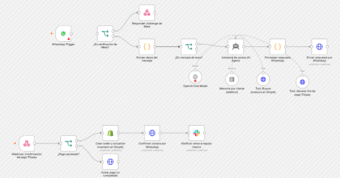

# WhatsApp sales agent (Shopify + payment link)

An AI agent that handles customer conversations on WhatsApp, checks real product data in Shopify, sends a payment link, and completes the order automatically once payment is confirmed.

**Status:** architecture prototype. The workflow is fully designed but has not been run end to end against live WhatsApp, Shopify and Tilopay accounts. The Tilopay endpoint is a placeholder until verified against Tilopay's developer documentation.

## How it works

**Flow 1: conversation**

1. **WhatsApp Trigger** receives incoming messages from the WhatsApp Cloud API and answers Meta's webhook verification challenge.
2. A code node extracts the phone number and text; non-text messages are filtered out.
3. **AI sales agent** (OpenAI chat model) with:
   - **Memory per customer**, keyed by phone number, so each conversation keeps its context.
   - **Tool: search Shopify products**, to confirm availability and price before answering.
   - **Tool: generate payment link**, used only after the customer confirms the purchase.
   - A system prompt that forbids inventing prices or links: the agent must always use its tools.
4. The reply is sent back through the WhatsApp Cloud API.

**Flow 2: payment confirmation**

1. A webhook receives the payment provider's confirmation.
2. If approved: create the paid order in Shopify (which updates inventory), confirm the purchase to the customer on WhatsApp and notify the team on Slack.
3. If not approved: tell the customer the payment did not go through.

## Requirements

- WhatsApp Cloud API (Meta) app and phone number
- Shopify store with Admin API access
- Tilopay merchant account (or another payment provider with payment links and webhooks)
- OpenAI and Slack credentials

## Setup

| Placeholder | Replace with |
| --- | --- |
| `TU_TIENDA` | Your Shopify store subdomain |
| `TU_PHONE_NUMBER_ID` | Your WhatsApp Cloud API phone number ID |
| Tilopay URL and body | Verify against Tilopay's developer documentation before use |

## Known limitations

- Shopify Admin API version in the URL (`2024-01`) should be updated to a currently supported version.
- Tilopay endpoint and payload are not verified.
- Only text messages are handled (no images, audio or locations).
